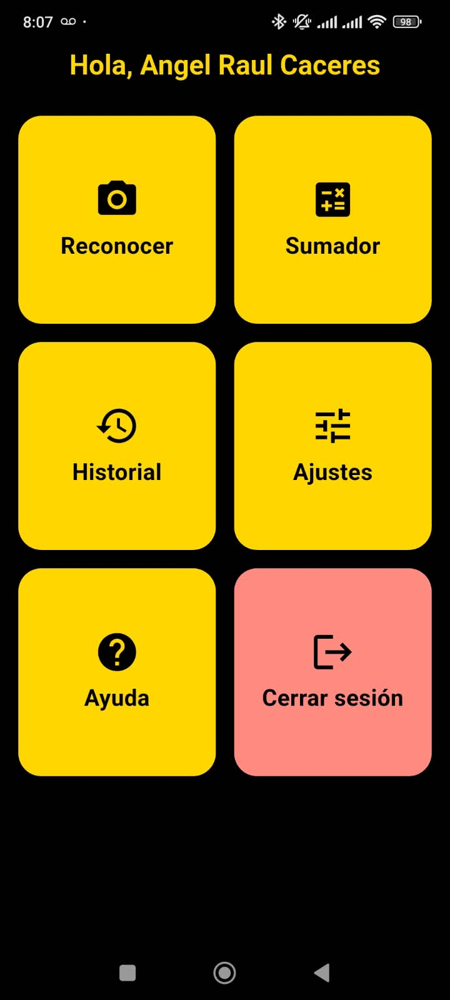
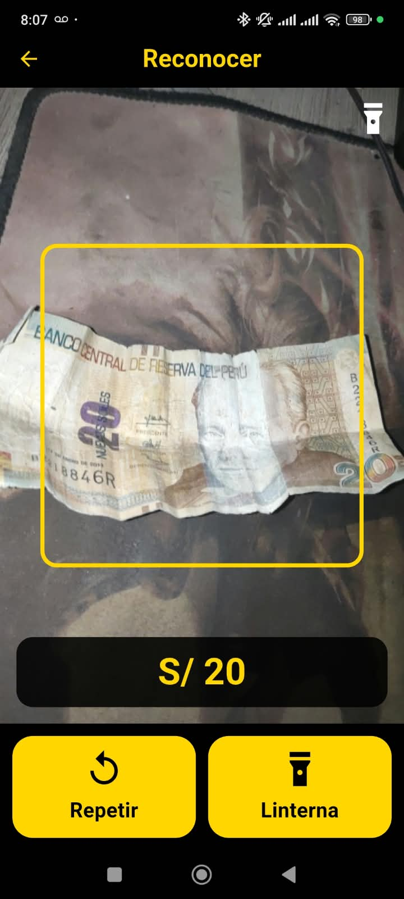

# Billetes Perú

Aplicación móvil accesible que reconoce billetes peruanos con la cámara y dice su valor en voz alta, pensada para personas ciegas o con baja visión. El modelo corre dentro del teléfono: no necesita internet.

Proyecto final del curso **Plataformas Emergentes** — Escuela Profesional de Ingeniería de Sistemas, Universidad Nacional de San Agustín de Arequipa.

**Autores:** Angel Raul Caceres Pari · Francis Willian Ayamamani Añasco

| Menú principal | Reconociendo un billete de S/ 20 |
|---|---|
|  |  |

## Qué hace

- **Reconocer:** apunta la cámara al billete y la app dice «Billete de cincuenta soles» con voz pausada tipo dictado, un tono y vibración. Si no está segura, se queda callada.
- **Sumador:** suma billetes uno por uno y, con un monto a pagar, dice cuánto falta o el vuelto.
- **Historial**, **cuentas locales** (o invitado), **ajustes** de voz, sonidos, vibración y linterna automática, y **ayuda** hablada.
- Interfaz de alto contraste, botones grandes y compatible con TalkBack/VoiceOver.

## Resultados del modelo

MobileNetV3-Small (transfer learning) exportado a TensorFlow Lite con cuantización: **1,13 MB**.

| Métrica (1237 imágenes de prueba) | Valor |
|---|---|
| Exactitud | 96,9 % |
| F1 macro | 0,969 |
| Veces que habla con umbral 0,85 | 94,3 % |
| Anuncios erróneos con umbral 0,85 | 0,77 % |

Versión 1: reconoce billetes de S/ 10, 20, 50 y 100 (series antigua y nueva). Aún no incluye S/ 200 ni monedas.

## Estructura del repositorio

```
billetes_app/                  App Flutter (Android e iOS) — ver billetes_app/README.md
entrenamiento_billetes.ipynb   Notebook de Google Colab: descarga el dataset, entrena, evalúa y exporta el modelo
modelo_v1/                     soles.tflite, labels.txt, curvas y matrices de confusión
articulo_ieee/                 Artículo en formato IEEE (LaTeX + PDF)
```

## Cómo usarlo

- **Instalar en Android:** descarga el APK desde [Releases](../../releases) (`app-arm64-v8a-release.apk` sirve para casi todos los celulares actuales).
- **Compilar la app:** con Flutter 3.44+, dentro de `billetes_app/` ejecuta `flutter run`.
- **Reentrenar el modelo:** abre `entrenamiento_billetes.ipynb` en Google Colab con GPU y ejecuta todas las celdas. Luego copia `soles.tflite` y `labels.txt` a `billetes_app/assets/modelo/`.

## Dataset

El dataset no está incluido en el repositorio (~915 MB). El notebook lo descarga automáticamente.

> N. E. Caytuiro-Silva, J. M. Peña-Alejandro, E. G. Castro-Gutierrez, J. Sulla-Torres y B. Maraza-Quispe, «Annotated Peruvian banknote dataset for currency recognition and classification», *Data in Brief*, vol. 51, 109715, 2023. Datos: [Mendeley Data](https://data.mendeley.com/datasets/22jmt8xhpn/1), doi:10.17632/22jmt8xhpn.1 — licencia CC BY 4.0.

La app no detecta billetes falsos.
