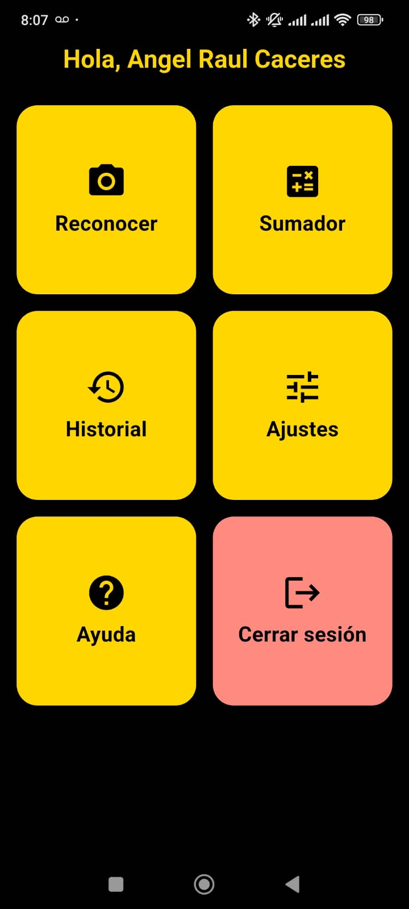
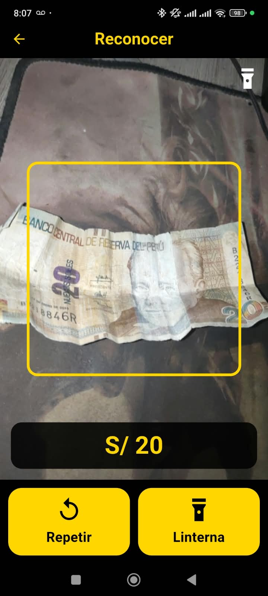

# Billetes Perú

App Flutter que reconoce billetes peruanos con la cámara y dice su valor en voz alta, pensada para personas ciegas o con baja visión. Todo funciona sin internet.

## Capturas (prueba en un celular real)

| Menú principal | Reconociendo un billete de S/ 20 (serie antigua) |
|---|---|
|  |  |

## Pantallas

| Pantalla | Qué hace |
|---|---|
| Iniciar sesión / Crear cuenta | Cuentas locales (solo en el teléfono, contraseña con SHA-256 + sal) o entrar como invitado |
| Menú | 6 botones grandes. Sin lector de pantalla: 1er toque = escuchar, 2do toque = abrir |
| Reconocer | Cámara continua; dicta "Billete de cincuenta soles" cuando está segura. Toque = repetir |
| Sumador | Suma billetes (toque para sumar o suma automática), deshacer, reiniciar y monto a pagar (dice cuánto falta o el vuelto) |
| Historial | Billetes reconocidos por usuario, resumen del día y lectura en voz alta |
| Ajustes | Velocidad, tono y voz, estilo dictado y pausa, sonidos, vibración, linterna automática, umbral de seguridad |
| Ayuda | Instrucciones habladas y lo que reconoce el modelo instalado |

## Estructura

```
lib/
  main.dart                 arranque y tema
  tema.dart                 alto contraste amarillo/negro
  datos/montos.dart         montos en palabras ("ciento setenta soles")
  datos/denominaciones.dart etiqueta del modelo -> valor y frase
  servicios/voz.dart        TTS estilo dictado + sonidos de aviso
  servicios/clasificador.dart  TFLite + preprocesado de la cámara
  servicios/ajustes.dart, cuentas.dart, historial.dart
  widgets/detector_camara.dart  cámara + votación 4 de 5 + linterna automática
  widgets/boton_grande.dart     botón accesible
  pantallas/                login, registro, inicio, reconocer, sumador, historial, ajustes, ayuda
assets/modelo/              soles.tflite + labels.txt (modelo v1)
assets/sonidos/             tonos de aviso
```

## Ejecutar

Con el celular conectado por USB (depuración USB activada):

```
flutter run
```

## Actualizar el modelo

1. Entrena de nuevo con el notebook `entrenamiento_billetes.ipynb` (agrega carpetas `b200`, `m1`, `fondo`, `moneda_escudo`, etc.).
2. Reemplaza `assets/modelo/soles.tflite` y `assets/modelo/labels.txt`.

Las clases nuevas se activan solas si su nombre está en `lib/datos/denominaciones.dart` (ya están `b200`, `m010`…`m5` y `moneda_escudo`). `fondo` hace que la app se quede callada.

Dataset: Caytuiro-Silva et al. (2023), *Peruvian Banknotes*, Mendeley Data, CC BY 4.0.
